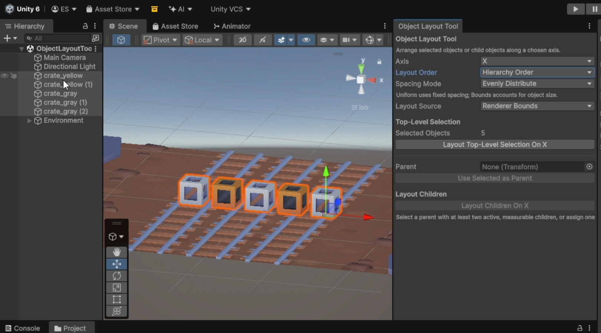
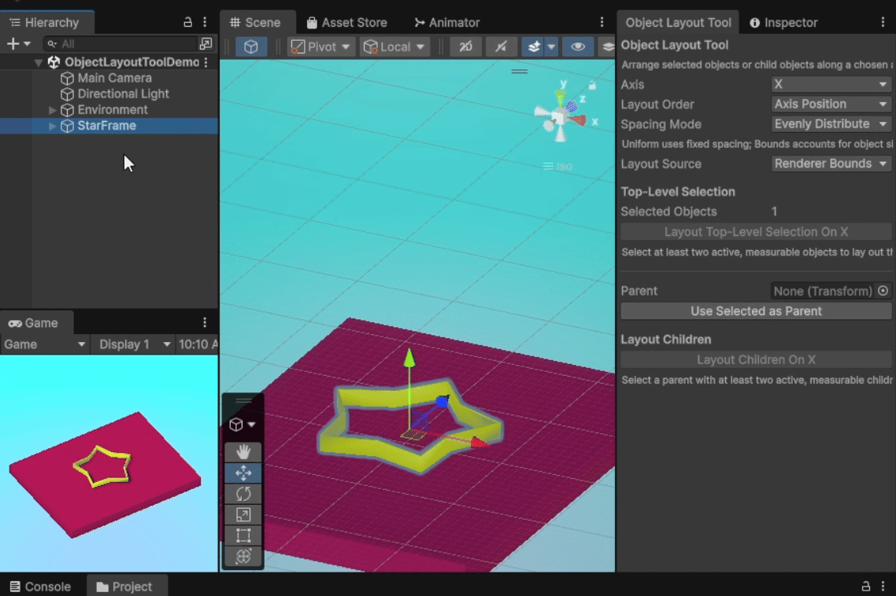

# Object Layout Tool

Object Layout Tool arranges selected GameObjects or a parent's direct children along a chosen world axis. It simplifies repetitive positioning with packing and even distribution options that can account for object bounds.


## Key Features

- Lays out top-level selected objects or the direct children of a chosen parent.
- Supports the `X`, `Y`, and `Z` world axes.
- Orders objects by axis position or hierarchy order before layout.
- Measures objects using `Renderer Bounds`, `Collider Bounds`, or `Transform Position`.
- Falls back from Renderer bounds to Collider bounds when no eligible Renderer bounds are found.
- Supports `Pack` spacing and `Evenly Distribute` spacing.
- Filters nested selections so selected child objects are not laid out twice when their selected parent is also included.
- Records moved transforms with Unity Undo.
- Uses only Unity built-in Editor APIs.

## Installation

Copy the Editor script into your Unity project:

```text
Assets/Editor/ObjectLayoutTools.cs
```

The script must remain inside an `Editor` folder because it uses UnityEditor APIs. No package setup or third-party dependencies are required.

## Usage

1. Open `Tools > Object Layout Tool`.
2. Choose the axis, layout order, spacing mode, and layout source.
3. To lay out selected objects, select two or more GameObjects and click `Layout Top-Level Selection On X`.
4. To lay out children, assign a `Parent` or select a parent GameObject, then click `Layout Children On X`.
5. Use Unity's normal Undo command to restore previous positions if needed.

The action button text updates with the selected axis, such as `On X`, `On Y`, or `On Z`.



## Layout Sources

`Layout Source` controls how each object is measured before layout:

- `Renderer Bounds`: uses enabled `Renderer` components in the active object hierarchy. `ParticleSystemRenderer` components are ignored. If no renderer bounds are found, enabled 3D Collider bounds are used as a fallback and a Console log message is written.
- `Collider Bounds`: uses enabled 3D `Collider` components in the active object hierarchy.
- `Transform Position`: treats the object's transform position as a zero-size point.

Objects without the selected source are skipped with a Console log message. Renderer Bounds is the only source with the Renderer-to-Collider fallback.

## Layout Order

`Layout Order` controls the order of objects before positions are changed:

- `Axis Position`: sorts by the selected axis position, with hierarchy path as a tiebreaker.
- `Hierarchy Order`: sorts by hierarchy path.

## Spacing Modes

`Pack` moves each item after the first so its measured minimum begins after the previous measured maximum plus `Spacing`.

`Spacing` is a world-space value used only by `Pack` mode. The field is hidden and ignored in `Evenly Distribute` mode.

`Evenly Distribute` keeps the first-to-last measured span and spaces the internal items between them.



## Selection / Hierarchy Behavior

`Layout Top-Level Selection` lays out the current selection after removing selected children whose selected parent is also included.

`Layout Children` lays out the selected or assigned parent's direct children. Measurement can still include enabled Renderer or Collider components within each child object's active hierarchy.

Inactive GameObjects are excluded from measurement. If fewer than two active, measurable objects remain, no layout is applied.

`Use Selected as Parent` assigns the single selected object to the `Parent` field and is enabled only when exactly one object is selected.

## Limitations

- Collider Bounds uses 3D `Collider` components, not `Collider2D`.
- `Renderer Bounds` ignores `ParticleSystemRenderer` components.
- Inactive GameObjects are excluded from measurement.
- Objects without a valid layout source are skipped, except Renderer Bounds can fall back to Collider Bounds.
- The tool moves transforms directly; it does not resize objects, modify meshes, or change pivots.
- `Evenly Distribute` can produce overlapping items if the first-to-last measured span is smaller than the total measured item size.
- Layout tools are disabled in Play Mode.

## Compatibility

Tested with Unity `6000.3.15f1`.

## 7 Tools in 7 Days — Day 5

This tool is part of the **7 Tools in 7 Days** series.

[Read the Day 5 development story on Substack](https://ecesefercioglu.substack.com/p/7-tools-in-7-days-day-5-object-layout)

| Day | Tool |
| --- | --- |
| Day 1 | [Parent From Bounds](https://github.com/seferciogluecce/parent-from-bounds) |
| Day 2 | [Separate Mesh Bodies](https://github.com/seferciogluecce/separate-mesh-bodies) |
| Day 3 | [Brick Wall Generator](https://github.com/seferciogluecce/brick-wall-generator) |
| Day 4 | [Particle System Context Previewer](https://github.com/seferciogluecce/particle-system-context-previewer) |
| **Day 5** | **[Object Layout Tool](https://github.com/seferciogluecce/object-layout-tool)** |
| Day 6 | [DOTween Selection Animation Previewer](https://github.com/seferciogluecce/dotween-selection-animation-previewer) |
| Day 7 | [Wave Object Distributor](https://github.com/seferciogluecce/wave-object-distributor) |

## License

This project is available under the MIT License. See [LICENSE](LICENSE).
